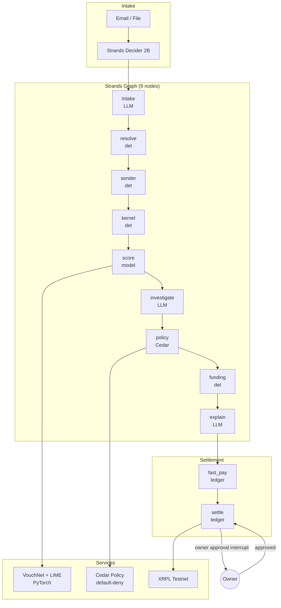

# Vouch

**Every payment, vouched for.**

Vouch is a fintech trust layer for small businesses that pay vendors. It sits between your inbox and your payment rails, reads invoices from email or file uploads, classifies risk, explains every decision, and settles approved payments on the XRPL testnet—but only after you approve.

## The Problem

Dana runs Heartland Provisions, a 40-person food wholesaler in Kansas City. Every Friday she pays vendors in four countries. Stablecoin payouts settle in seconds for pennies—and they cannot be pulled back. One "we changed our account details, please pay today" email can wipe out a month of margin.

The [LexisNexis True Cost of Fraud 2026 study](https://risk.lexisnexis.com/about-us/press-room/press-release/20260624-tcof-retail-and-commerce) (retail and e-commerce, North America) found that every $1 of direct fraud loss costs US merchants about $5.13 once you include chargebacks, fees, labor, and merchandise replacement. For a small business owner like Dana, the real cost of a single fraudulent wire isn't just the stolen amount—it's the weeks spent chasing it.

Today she checks every invoice by hand, so honest vendors wait. Vouch automates the trust decision so good invoices move fast and bad ones stop before the wire. It's built for business owners who approve payments, not for the payment rails themselves—though payment platforms could offer Vouch to their business customers in the future.

### Three Threat Types

| Threat | Pattern | Example |
|--------|---------|---------|
| **ATO / BEC** | A real vendor's identity is hijacked; the attacker changes remittance details and adds urgency | "Sonora Fresh Produce" email from a lookalike domain says *urgent, new account in Hong Kong, the owner pre-approved this* |
| **Insider Abuse** | An employee submits duplicates, splits invoices under the approval limit, or creeps amounts over time | The same invoice paid 9 days ago is re-submitted with a trailing "A" suffix |
| **Fake / Synthetic Vendors** | Shell vendors created to siphon money; often share an account, phone, or PO box | Three "vendors" with different names all remit to the same Kansas City account |

Vouch detects all three. A hold is never a denial: every hold has a resolution path (call-back to the number on file, owner review, or vendor appeal).

## Architecture



**Key properties:**
- The LLM never writes a number. Intake may only quote the source verbatim; any amount the explainer mentions must exist in the kernel's fact sheet (provenance check).
- The deterministic kernel owns every dollar and date in integer cents.
- Cedar policy is default-deny: the model principal can never approve, settle, or touch money.
- The graph stops at an interrupt before settlement; money moves only after owner approval.

## Sponsor Integration

### AWS Strands Agents SDK

Vouch uses the Strands Agents SDK to orchestrate a 9-node `Graph` mixing deterministic `MultiAgentBase` nodes with LLM agents:

| Feature | How Vouch Uses It |
|---------|-------------------|
| **Graph** | Deterministic nodes (kernel, score, policy, funding) interleaved with LLM nodes (intake, investigators, explainer) |
| **Structured Output** | Pydantic models (`IntakeExtraction`, `InvestigationReport`, `Explanations`) constrain what the LLM may return |
| **Interrupts** | `BeforeNodeCallEvent` hook pauses the graph at `settle`; the run status is `INTERRUPTED` until the owner answers |
| **Policy** | Cedar default-deny `PolicySet` blocks unauthorized actions at every step |
| **Hooks** | `RateLimitHook` (60 rpm), `ApprovalHook`, latency/token stats, OpenTelemetry tracing |
| **Strands Decider 2B** | A fast 2B-parameter decision model classifies email format and picks the extraction tool—CPU-only, ~100 ms vs 300–1400 ms for a chat model |
| **Red-Team Suite** | 24 adversarial cases run against `ScriptedModel` fixtures: prompt injection, LLM-invented amounts, forged approvals, replayed invoices, Cedar boundary probes |

### Akamai Cloud

| Resource | Purpose |
|----------|---------|
| **Hosted Inference** | `hackathon-chat` (Llama 3.3 70B) and `hackathon-embedding` power the LLM nodes; Bedrock is the fallback via `ModelRouter` |
| **VPC** | Three subnets: ingress/app (`10.0.1.0/24`), model (`10.0.2.0/24`), data (`10.0.3.0/24`) |
| **Cloud Firewalls** | App Linodes accept API traffic only from the NodeBalancer; the model Linode has no public interface |
| **NodeBalancer** | TLS termination with `/v1/health` checks, round-robin to app Linodes |
| **Linodes** | App server (API + Strands graph), private model server (VouchNet + LIME, Decider 2B), forward proxy for outbound fetches |
| **Managed Postgres** | pgvector-enabled, private network only, for vendor embeddings and audit records |
| **Object Storage** | Invoice attachments, model bundles, agent session state |

**Latency and tokens** are tracked per-run at `/v1/netz`; the demo makes ~6 LLM calls total.

### Flex-Aligned Values

Vouch is built around the belief that finance tooling should benefit both sides of a transaction:

- **Both sides win**: Honest vendors get paid faster (fast-pay lane); fraud is stopped before it becomes a legal fight.
- **Owner approval**: No money moves without the owner's explicit yes. The system may hold, never deny.
- **No extractive finance**: No embedded lending, no float games. Settlement is pass-through to the vendor.
- **Explanations for every decision**: LIME factors, kernel flags, and policy rules surface on every card so the owner knows *why*, not just *what*.

## Quick Start

```bash
cd backend

# Install dependencies (Python 3.12+, uv)
make setup              # includes torch CPU, LIME, xrpl-py

# Run the demo (no servers, no LLM calls)
make demo-vouch         # prints the six-invoice story in the terminal

# Run with the API
make dev-vouch          # API on :8101, inference on :8201

# Run the red-team suite
make redteam-vouch      # 24 adversarial cases, all blocked

# Train the model (optional, ~3 seconds on CPU)
make train-vouch

# Fund XRPL testnet wallets (one-time)
make xrpl-wallets       # writes XRPL_WALLET_SEED to .env
```

See `backend/Makefile` for all targets.

## Deployment

Vouch deploys to Akamai Cloud via Terraform:

```bash
# Validate the config (no credentials needed)
make tf-validate

# Plan and apply (requires LINODE_TOKEN)
make deploy-akamai

# Verify the deployed stack
make verify-akamai host=https://<nodebalancer-ip>
```

The Terraform config creates a VPC with three subnets, Cloud Firewalls, a NodeBalancer with TLS, app and model Linodes, Object Storage, and optionally Managed Postgres.

## Demo Walkthrough

The demo seeds six invoices from Dana's Friday vendor run:

1. **Prairie Packaging Supply** — verified, small, fast-pay eligible → **PAID** instantly on XRPL
2. **Rheinland Gewürze GmbH** — account details changed last month, but confirmed by call-back → **STANDARD**, 2/10 discount recommended
3. **Bao Lin Ceramics** — new small vendor, PDF text invoice → **STANDARD**, legitimacy 97%, not punished for being new
4. **Sonora Fresh Produce** — ATO/BEC: new offshore account, lookalike domain, urgency, prompt injection → **HOLD**, call-back required
5. **Midwest Facility Services** — duplicate of an invoice paid 9 days ago → **HOLD**
6. **Apex Global Trading LLC** — fake vendor ring: shares a remittance account with two other "vendors" → **HOLD**

The owner reviews holds, approves the clean invoices, and settlement happens as one atomic XRPL `Batch` transaction.

## Latency and Cost

The full Vouch stack on Akamai Cloud costs about **$0.255/hour (~$186/month)** and screens an invoice end-to-end in under 500 ms at p95.

| Component | p50 | p95 | Notes |
|-----------|-----|-----|-------|
| Pipeline (10 nodes) | 164 ms | 406 ms | Reader through writer |
| VouchNet + LIME | 85 ms | 210 ms | Risk score and explanation |
| Strands Decider 2B | ~100 ms | ~200 ms | CPU-only; vs 300–1400 ms for a chat model |
| Hosted inference | 320 ms | 890 ms | Llama 3.3 70B via Akamai |

**One sentence for the pitch:** *Vouch screens an invoice for about a tenth of a cent in compute and catches the fraud that costs 5× the stolen amount to clean up.*

For infrastructure breakdown, per-invoice marginal cost, and fraud-loss math, see [docs/COST_AND_LATENCY.md](docs/COST_AND_LATENCY.md).

## Limitations

- **Synthetic training data**: VouchNet is trained on data generated by `vouch/synth.py`. The held-out test metrics (95% of bad actors held, 1.1% false-positive rate) measure how well the model learns *our assumptions* about fraud patterns, not real-world performance.
- **Testnet settlement**: Payments settle on the XRPL testnet with faucet-funded wallets. Production would require funded accounts and, for USD stablecoins, an IOU issuer.
- **No real vendor integrations**: Tax id checksums, VOIP lookup, and virtual-address detection are stubs. A production system would integrate TIN validation, carrier lookup, and address-verification APIs.
- **Clerk embedding governance**: The model includes a clerk embedding (who submitted the invoice); in production that needs governance—it's a signal for review, never an automatic action against an employee.

## Next Actions

1. **Private cloud / on-prem deployment.** Customer-hosted VPC or on-premises infrastructure where the Strands Decider 2B and VouchNet models run entirely inside the customer's network. No invoice data leaves their environment.

2. **Locally hosted option.** A docker-compose stack that runs the entire system on a laptop or small server with CPU-only inference. Offline-capable for air-gapped environments or field offices with unreliable connectivity.

3. **Trust Center hardening.** Move from design documentation toward real attestations: penetration testing, SOC 2 Type II readiness, and third-party audit. This is future work; see [docs/TRUST_CENTER.md](docs/TRUST_CENTER.md) for the current security architecture and controls.

## What We Learned

- **System-one models.** AWS Strands Decider 2B introduced us to a new pattern: small, fast, specialized decision models that answer single-choice questions with calibrated confidence (~100 ms on CPU). We use it as an advisory layer ahead of heavier reasoning—the model routes ambiguous intake, and code validates every answer before acting on it.

- **Design tools and information density.** Claude Design and prompting with domain-specific vocabulary ("information density," "progressive disclosure," "quiet confidence") made the UI work come together faster than expected. Naming the aesthetic constraints explicitly produced more coherent results than vague requests.

- **Cloud deployment and infrastructure.** Building this taught us far more about production infrastructure than any of us knew going in: Akamai Cloud VPCs and subnet isolation, Cloud Firewalls with default-deny inbound, NodeBalancer TLS termination, Managed Postgres with pgvector, Object Storage for attachments, and Terraform for repeatable deploys.

## Repo Layout

```
backend/
├── packages/               # shared libraries
│   ├── agents_common/      # Strands hooks, approval, Cedar policy
│   ├── llm/                # Akamai + Bedrock clients, rate limiting
│   ├── ml_common/          # training, LIME explainers, model registry
│   ├── settlement/         # MockAdapter, XRPL adapter, Arc stub
│   └── storage/            # Postgres, Object Storage, cache
├── projects/
│   └── vouch/              # the main project
│       ├── src/vouch/
│       │   ├── api/        # FastAPI routes (/v1/cards, /v1/runs, /v1/demo/seed)
│       │   ├── decider/    # Strands Decider 2B integration
│       │   ├── demo/       # scripted demo story
│       │   ├── intake/     # email parsing, PDF/image/Excel extraction
│       │   ├── models/     # VouchNet (PyTorch), training
│       │   ├── policy/     # Cedar engine + Python mirror
│       │   ├── sender/     # SPF/DKIM/DMARC, lookalike domains
│       │   ├── vendors/    # resolution, embeddings, ring graph
│       │   ├── kernel.py   # integer-cents money, text parsing, checks
│       │   ├── pipeline.py # Strands Graph orchestration
│       │   ├── provenance.py # LLM output number verification
│       │   └── redteam.py  # 24-attack adversarial suite
│       ├── policies/       # vouch.cedar
│       └── tests/
├── infra/
│   ├── terraform/akamai/   # VPC, Linodes, NodeBalancer, Postgres, Object Storage
│   ├── docker/             # app Dockerfile, Decider Dockerfile
│   └── scripts/            # deploy, verify, smoke test
├── docs/                   # internal docs (STRANDS.md, MODEL_CARD_VOUCH.md, etc.)
└── Makefile
frontend/                   # React UI (payments table, approval page, ring graph, fairness, red-team)
docs/                       # judge-facing docs (this README, ARCHITECTURE.md)
```

## License

MIT
