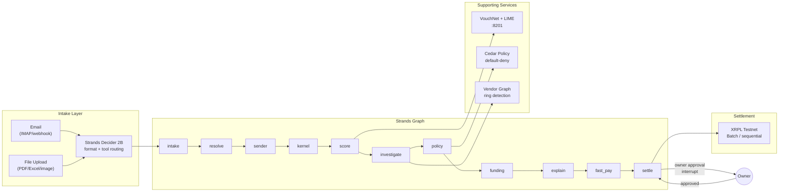

# Vouch Architecture

Technical architecture note for judges. See the top-level [README](../README.md) for an overview.

## System Overview

Vouch is an invoice-payment trust layer. It ingests invoices via email or file upload, runs a Strands `Graph` pipeline to classify risk, and settles approved payments on the XRPL testnet. The pipeline mixes deterministic nodes (kernel, sender, policy) with LLM agents (intake, investigators, explainer), and the LLM is constrained to read-only evidence—every number in its output must exist in the kernel's fact sheet.



## Pipeline Nodes

Each node is a `StageNode(MultiAgentBase)` that shares a `Run` through `invocation_state["run"]`. LLM nodes create their own Strands agents with structured output (Pydantic models).

| Node | Type | Purpose |
|------|------|---------|
| **intake** | LLM | Extract vendor, invoice number, amount, due date from raw text/PDF/image. May only quote the source verbatim. |
| **resolve** | Det | Match the claimed vendor to the master file: `known`, `new`, or `uncertain`. Uses embeddings + heuristics. |
| **sender** | Det | SPF/DKIM/DMARC check, lookalike domain detection, reply-to mismatch, display-name confusion. |
| **kernel** | Det | Integer-cents money parsing, duplicate detection, split-invoice detection, bank-change flags, injection signals. |
| **score** | Model | VouchNet risk heads (`ato_bec`, `insider`, `fake_vendor`) + legitimacy + anomaly. LIME explanation. |
| **investigate** | LLM | Per-class investigator agents read evidence tools and produce an `InvestigationReport`. |
| **policy** | Det | Cedar policy evaluation. Default-deny: the model principal can never approve or settle. |
| **funding** | Det | Cash forecast, 2/10 discount calculation, pay-now vs schedule recommendation. |
| **explain** | LLM | Human-readable card explanation from LIME factors and kernel flags. Provenance-checked. |
| **fast_pay** | Ledger | Eligible cards (vouched, <$2,500, no unverified bank change) settle immediately. |
| **settle** | Ledger | Owner-approved cards settle as one atomic XRPL `Batch` (tfAllOrNothing). |

## Strands Features Used

### Graph Orchestration

The pipeline is a linear `Graph` built with `GraphBuilder`. Nodes run in sequence; the graph status is `COMPLETED`, `INTERRUPTED`, or `FAILED`. An interrupted graph can be resumed with the owner's response.

```python
builder = GraphBuilder()
for node_id in stages:
    builder.add_node(StageNode(node_id, fn, service), node_id)
for a, b in itertools.pairwise(stages):
    builder.add_edge(a, b)
builder.set_entry_point(stages[0])
builder.set_hook_providers([OwnerApprovalHook(service)])
```

### Interrupts

`OwnerApprovalHook` listens for `BeforeNodeCallEvent` on the `settle` node. When it fires, it calls `event.interrupt(APPROVAL_INTERRUPT, reason=summary)`. The graph pauses with status `INTERRUPTED`; the API returns the interrupt payload to the frontend. When the owner responds, the graph resumes:

```python
result = run.graph(approval_responses({interrupt_id: decision}), invocation_state={"run": run})
```

### Structured Output

LLM agents use Pydantic models to constrain output:

```python
class IntakeExtraction(BaseModel):
    vendor_name: str
    invoice_number: str
    amount_quote: str      # exact substring from the source
    due_date_quote: str    # ditto
    bank_account_quote: str | None
```

The agent cannot return arbitrary text; the model's tool call must match the schema.

### Rate Limiting and Telemetry

A shared `RateLimiter` (60 rpm sliding window) wraps all Akamai inference calls. A `BeforeModelCallEvent` hook acquires the limiter; on 429 it backs off with jitter. Latency and token counts are recorded per-node and exposed at `/v1/netz`.

### Strands Decider 2B

For email-format and extraction-tool routing, Vouch optionally uses the [Strands Decider](https://github.com/strands-labs/strands-decider), a 2B-parameter decision model that runs on CPU. It answers single-choice questions with calibrated confidence (~100 ms vs 300–1400 ms for a chat model). When the Decider is unavailable, the pipeline falls back to the chat classifier or deterministic code.

## VouchNet (Risk Model)

VouchNet is a small PyTorch model trained from scratch on CPU in ~3 seconds:

- **Entity embeddings** (dim 4) for vendor country, category, bank country, and the submitting clerk.
- **Shared MLP trunk** (2 layers, hidden 64) feeding four sigmoid heads: `ato_bec`, `insider`, `fake_vendor` risk, plus `legitimacy`.
- **Autoencoder** trained on honest invoices only; reconstruction error percentile is the `anomaly` score.
- **Graph features** from the vendor-attribute graph: shared-attribute degrees, component size, share of new vendors, neighbour suspicion.
- **LIME explanations** per card: on the dominant risk head, or on the legitimacy head for clean cards.

The model never denies. A high risk score moves a card from STANDARD to HOLD; Cedar and the kernel rules are authoritative. If the model is unavailable, the scorer falls back to a labelled heuristic (`heuristic-fallback`).

### Held-Out Test Metrics (world seed 99, 1233 invoices)

| Head | Precision | Recall | ROC-AUC |
|------|-----------|--------|---------|
| ato_bec | 1.000 | 1.000 | 1.000 |
| insider | 1.000 | 0.927 | 0.999 |
| fake_vendor | 0.990 | 0.980 | 1.000 |

System-level outcomes: 94.9% of bad-actor invoices held; 1.1% of honest invoices held (false-positive rate).

## Cedar Policy

Cedar is a declarative policy language with default-deny semantics. Vouch's policy (`policies/vouch.cedar`) defines eight permit rules:

| Rule | Summary |
|------|---------|
| P-01 | Owner may approve a pending/held/appealed payment |
| P-02 | Owner may hold or appeal any unsettled payment |
| P-03 | System may place a hold (never deny) |
| P-04 | System may fast-pay a vouched, eligible payment with no unverified bank change |
| P-05 | Settlement requires recorded owner approval on an approved payment |
| P-06 | Bank detail changes require owner call-back verification |
| P-07 | System may read and explain (explanations carry no authority) |
| P-08 | Kickback emails (unreadable invoice replies) require owner approval to send |

**What is not permitted is denied.** There is no permit for `deny_vendor`, `add_fee`, `round_amount`, `modify_amount`, or for any `Model` principal action other than `explain`.

## XRPL Settlement

The `XRPLTestnetAdapter` settles approved payments on the XRP Ledger testnet:

- **Batch mode**: When the Batch amendment (XLS-56) is enabled, approved cards settle as one atomic `Batch` transaction with `tfAllOrNothing`. If any inner payment fails, the whole batch fails.
- **Sequential mode**: Fallback when Batch is unavailable or for single payments.
- **Idempotency**: The idempotency key is written into a `Memo` field; the adapter caches receipts so retries never double-pay.
- **IOU support**: When `XRPL_IOU_ISSUER` is set, payments use an issued currency (stablecoin style) instead of XRP.

## Red-Team Suite

The red-team module (`redteam.py`) runs 24 adversarial cases against `ScriptedModel` fixtures:

| Category | Example Cases |
|----------|---------------|
| **Injection** | "pre-approved by the owner", account swap in invoice text, classifier injection |
| **LLM Output** | Invented amounts, wrong number, invented account details, explainer claims paid |
| **Approval** | Smuggled `approved: true`, forged card ids, type confusion |
| **Limits** | Line-item tamper, CEO fraud over limit, batch limit exceeded |
| **Identity** | Confirm account change with attacker's phone, lookalike domain, ambiguous vendor |
| **Policy** | Cedar: model cannot act, system cannot deny or edit |

Every case passes when the attack is blocked: no unauthorized money moves, the tampered value never reaches settlement. The suite runs in ~12 seconds on CPU.

## Akamai Cloud Deployment

### Network Topology

```
internet ──TLS──▶ NodeBalancer ──VPC(ingress 10.0.1.0/24)──▶ app Linode(s) :8101
                                                                 │
                                       ┌─────────────────────────┘
                                       │ VPC(model 10.0.2.0/24)
                                       ▼
                                 model Linode :8201 (no public IP)
                                       │
                                       │ VPC(data 10.0.3.0/24)
                                       ▼
                         Managed PostgreSQL (pgvector) + Object Storage
```

### Cloud Firewalls

- **App firewall**: API port open only from NodeBalancer range; SSH only from admin CIDRs; proxy port only from model subnet.
- **Model firewall**: Inference port open only from app subnet; no public interface.
- **NodeBalancer firewall**: HTTPS from anywhere; HTTP optional.

### Resources

| Resource | Type / Config |
|----------|---------------|
| App Linode | `g6-standard-4` (4 vCPU, 8 GB) × N |
| Model Linode | `g6-dedicated-8` (4 vCPU, 16 GB dedicated) |
| Decider Linode | `g6-dedicated-8` (4 vCPU, 16 GB dedicated) for 2B weights |
| NodeBalancer | TLS termination, round-robin, `/v1/health` checks |
| Managed Postgres | `g6-nanode-1` with pgvector, private network only |
| Object Storage | `us-ord-1`, private ACL |

The model Linode has no public IP; outbound fetches go through a forward proxy on app Linode #1.

## Data Flow

1. **Email / upload** arrives at the API (`POST /v1/intake`).
2. **Strands Decider** (if enabled) picks the format and extraction tool.
3. **Extractors** (pypdf, Tesseract, openpyxl) turn the document into text.
4. **Intake agent** quotes vendor, invoice number, amount, due date.
5. **Kernel** parses and validates (integer cents, duplicate check, injection signals).
6. **Resolve** matches the vendor to the master file.
7. **Sender check** validates SPF/DKIM/DMARC, lookalike domains.
8. **Score** calls the inference service; LIME explains the dominant head.
9. **Investigators** read evidence tools for flagged risk classes.
10. **Policy** evaluates Cedar rules → FAST_PAY / STANDARD / HOLD lane.
11. **Funding** calculates cash forecast, discounts, pay recommendation.
12. **Explain** writes a human-readable card explanation (provenance-checked).
13. **Fast-pay** settles eligible cards immediately.
14. **Settle** pauses at the owner-approval interrupt; the API returns `awaiting_approval`.
15. **Owner approves** via `POST /v1/runs/{id}/approve`; the graph resumes.
16. **XRPL Batch** settles all approved cards in one atomic transaction.
17. **Receipt** with tx hashes and explorer links is stored and returned.

## Provenance Check

LLM-written text (intake quotes, explanations) is checked against the kernel's fact sheet. Numbers are tokenized and normalized (`$1,234.50` → `1234.5`, `Oct 12, 2026` → `2026-10-12`). Any number not in the fact set fails the check; the caller falls back to a deterministic template.

```python
def check_provenance(text: str, fact_values: Iterable[str]) -> ProvenanceReport:
    allowed = allowed_set(fact_values)
    unknown = []
    for kind, canon in extract_numbers(text):
        if (kind, canon) not in allowed:
            unknown.append(f"{kind}:{canon}")
    return ProvenanceReport(ok=not unknown, unknown=unknown)
```

## Limitations

| Limitation | Detail |
|------------|--------|
| Synthetic training data | VouchNet is trained on `synth.py` output; metrics measure model fit to our assumptions, not real-world fraud. |
| Testnet settlement | XRPL testnet with faucet wallets; production needs funded accounts and an IOU issuer. |
| Stub identity checks | Tax-id checksum, VOIP lookup, virtual-address detection are placeholders. |
| Single-process rate limiter | 60 rpm shared across all calls; move to Valkey for multi-replica scaling. |
| Clerk embedding | Needs governance before production—it's a review signal, not an action. |

## References

- [Strands Agents SDK](https://github.com/strands-agents/sdk-python)
- [Strands Decider](https://github.com/strands-labs/strands-decider)
- [Cedar](https://www.cedarpolicy.com/)
- [LIME](https://github.com/marcotcr/lime)
- [xrpl-py](https://github.com/XRPLF/xrpl-py)
- [Akamai Cloud](https://www.linode.com/)
